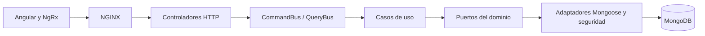

# Arquitectura de la solución

La aplicación implementada es un monolito modular, no un conjunto de microservicios distribuidos. Auth y Products tienen límites independientes y una conexión Mongo compartida mediante DatabaseModule.



- Domain: entidades, reglas y contratos de repositorios/seguridad sin dependencias Nest/Mongoose.
- Application: casos de uso, entradas/salidas, commands y queries. Los handlers integran Nest CQRS e inyección: esta capa tiene un acoplamiento explícito y limitado; los flujos de negocio y mensajes permanecen independientes.
- Infrastructure: HTTP/DTO, schemas, mappers, repositorios y criptografía.
- Composition: módulos Nest y DatabaseModule. API y seed son procesos independientes, cada uno con su conexión gestionada.

Los controladores envían seis comandos y tres consultas a los buses. No duplican reglas ni acceden a modelos Mongo. Los adaptadores traducen documentos a entidades y normalizan fallos de persistencia. Los índices pertenecen a los schemas de infraestructura; el caso de uso depende del puerto.

La interfaz usa NgRx para filtros, página y orden compartibles con la URL. Formularios y diálogos son locales a su componente. El access token vive en memoria, fuera del store; el refresh en cookie HttpOnly. Las respuestas de paginación proceden del backend, no de recortar una lista completa en el navegador.

Docker separa API, frontend estático/NGINX y Mongo persistente. Solo se expone el puerto local8080. Las imágenes de API/web ejecutan usuarios sin privilegios, con filesystem de solo lectura y temporales en tmpfs. La revisión HTTP usa NODE_ENV=development; la imagen API conserva production como valor por defecto y sus restricciones de seguridad.

## Límites conocidos

La paginación usa offset, no cursor. El conteo y los elementos pueden observar cambios concurrentes. El rate limit es por proceso y ve al proxy como IP remota. La renovación coordinada es por instancia de navegador: varias pestañas pueden provocar la política de revocación por replay. El access JWT conserva validez hasta expirar tras logout. No se implementan registro público, roles, OAuth federado, Event Sourcing, colas ni servicios cloud.

El ejercicio3 propone una arquitectura futura de microservicios para el sector agropecuario; esa propuesta se explica en el informe y no se presenta como código ya desplegado.

## Organización del frontend

Se conservan las áreas Auth y Products y se separan sus archivos por responsabilidad:

```text
app/
  auth/
    pages/login/
    services/
    interceptors/
    guards/
    models/
    utils/
  products/
    pages/catalog/
    components/product-editor/
    services/
    store/
    models/
    constants/
    validators/
    utils/
  core/
    config/
    utils/
  shared/
    components/confirm-delete/
    utils/
```

Las páginas son entradas del router; los componentes contienen su TypeScript y HTML juntos en su propia carpeta. Los servicios acceden a la API o gestionan la sesión, los interceptores procesan HTTP y los guards controlan la navegación. Los modelos describen datos de su área. NgRx queda en store, los valores predeterminados en constants y la conversión de parámetros de URL en utils. Los validadores de formularios se agrupan en validators. Las pruebas permanecen junto al archivo que verifican.
